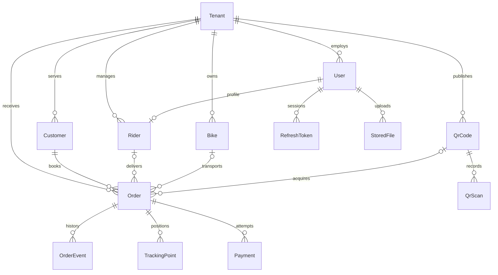

# EcoDispatch — Logistics System

**MIT 8103 Advanced Database Systems: server and portfolio overview**  
**Student name / ID:** ________________________  
**GitHub repository:** [Retpaul/Logistics-System](https://github.com/Retpaul/Logistics-System.git)  
**Documentation updated:** 16 November 2026  
**Evidence dates:** PostgreSQL benchmark/transactions, 12 November 2026; MongoDB verification, 15 November 2026.

This README is a self-contained account of the project, Portfolios 1–4, recorded results, reproduction commands and remaining work. Repository links provide the full source and evidence when submitted together. If this file is uploaded alone, its explanations and result summaries remain readable, but relative links require the repository; a single README does not replace the practical evidence or assessor repository access.

## Project and users

EcoDispatch is a realistic simulated logistics platform for delivery booking, courier allocation, delivery-status updates and tracking. The stored demonstration organisation is **Demo Couriers**; its dataset has not been renamed to imply a real commercial customer.

| User | Main operations |
| --- | --- |
| Owner | Manage organisation settings and operational access |
| Dispatcher | Create, search, assign and monitor delivery orders |
| Rider/courier | Claim jobs, update delivery status and submit location/proof information |
| Customer | Book using QR links and view public delivery tracking |

Couriers represent drivers, delivery orders represent trips, and customer/recipient records represent the people requesting or receiving deliveries. Request matching uses **manual assignment or rider claiming**. Passenger ride-hailing and automatic nearest-driver matching are outside the implementation.

The normal delivery sequence is `PENDING → ASSIGNED → PICKED_UP → IN_TRANSIT → DELIVERED`; cancellation and pre-pickup decline have separate service rules. Order events preserve the status history.

## Architecture and implementation status

The server uses **Node.js, Express 5, TypeScript, PostgreSQL and Prisma**. Mongoose defines the MongoDB models; Socket.io supports live-update code; AWS SDK v3 provides private S3 storage helpers. Exact dependency versions are pinned in `package-lock.json`.

Requests pass through `routes/ → middleware/controllers/ → services/ → repositories/ → PostgreSQL`. Shared contracts validate payloads. Services own status transitions and transactional workflows; repositories scope database operations to the authenticated tenant. UUIDs identify records, decimal types preserve money, and timestamps record business history.

| Area | Current position |
| --- | --- |
| Operational database | PostgreSQL remains authoritative for normal API reads/writes |
| Core API | Authentication, tenants, orders and public booking/tracking are implemented |
| Phase 2 | Rider onboarding, assignment/claiming, QR management, analytics, proof/GPS and Socket.io code exist; local activation requires migration recovery |
| MongoDB | Isolated models plus a verified, explicitly imported reporting sample; no continuous replication or API switch |
| S3 | Private blob-storage foundation exists; AWS configuration and deployed operation are separate verification steps |
| Payments | Payment records are modelled; Stripe/card processing and successful-payment evidence are not implemented |
| Live tracking | Device-GPS and map-update code exists; legacy imported coordinates do not prove real-device or deployed tracking |
| Portfolio 5 | Excluded from this arrangement; still outstanding for the complete assessment |

The existing PostgreSQL conflict involves a rider with multiple active assignments. Those records and history are preserved for manual resolution. This README does not claim that all committed migrations have been applied to that database.

## Portfolio 1 — Database design and modelling

**Requirement:** case study, ER diagram, relational schema, keys, constraints and normalisation.

The committed schema contains **13 models**:

| Model | Purpose / important relationships |
| --- | --- |
| Tenant | Organisation identity, branding and currency |
| User | Tenant account, role and authentication hash |
| RefreshToken | Hashed session token and rotation family; belongs to User |
| Rider | User-linked courier, availability, onboarding and last location |
| Bike | Tenant-owned vehicle and battery state |
| Customer | Tenant customer/contact record |
| QrCode | Tenant booking entry point and campaign |
| QrScan | QR scan event |
| Order | Delivery, recipient snapshot, allocation, fee, endpoints and lifecycle |
| StoredFile | User-owned S3 metadata; no binary file contents |
| OrderEvent | Appendable delivery-status history |
| TrackingPoint | Order location sample with provenance/accuracy |
| Payment | Order payment attempt, amount, currency and state |



Every table has a UUID primary key. Unique keys include tenant subdomain, tenant/email, tracking code, QR code, file key and nullable payment provider reference. Composite tenant foreign keys prevent cross-tenant relationships. SQL checks constrain money, currency, battery, coordinates, endpoint pairing, location source/accuracy and selected account/branding formats. A partial unique index permits at most one ASSIGNED/PICKED_UP/IN_TRANSIT order per non-null rider.

RefreshToken deletes cascade from User; other foreign-key deletes restrict removal. `Order.proofFileId` is a logical reference without a SQL FK, so services must check file ownership/existence. Foreign keys do not authorize reads or enforce every business transition.

**Normalisation:** 1NF uses scalar fields and separate history rows; 2NF ties attributes to their complete candidate keys; 3NF separates tenant, account, rider, vehicle and customer attributes. Deliberate redundancy includes tenant IDs for composite integrity, cached order status/delivery timestamps and historical booking/payment snapshots. These require atomic updates and mean the physical design is not uniformly strict 3NF.

**Sources:** [case study](portfolio-1-database-design/case-study.md), [database guide](docs/DATABASE.md), [Prisma schema](prisma/schema.prisma), [SQL migrations](prisma/migrations/) and [design export](portfolio-1-database-design/evidence/er-diagram.svg). The committed schema describes the intended design; it is not a claim of completed local rollout.

## Portfolio 2 — Query processing and optimisation

**Requirement:** SQL, query results, execution plans, indexing evidence and performance analysis.

The historical benchmark tested **15 queries against one million synthetic orders** in a separate performance database. The primary run used PostgreSQL 18.6, localhost, warm cache, five warm-ups and 50 timed executions per query. A PostgreSQL 17 run provides a separate cross-check. These datasets are unrelated to the current 32-order source and 20-order MongoDB sample.

| Query | p95 before | p95 after | Interpretation |
| --- | ---: | ---: | --- |
| Q03 newest 25 orders | 232 ms | 0.95 ms | Tenant/date index avoids the earlier scan/sort workload |
| Q13 recipient-phone search | 271 ms | 0.72 ms | Tenant/phone index narrows lookup |
| Q11 QR analytics | 1,034 ms | 9.60 ms | Indexed filtering reduces work |
| Q10 rider leaderboard | 2,418 ms | 460 ms | Improved, but still exceeds the 300 ms p95 target |
| Q05 delivered-status list | 0.79 ms | 0.81 ms | Essentially unchanged/slightly slower |

Q03's recorded plan changes from bitmap access plus top-N sort to an ordered index scan; touched buffers fall from 36,869 to 28. Indexing is not free: Order index storage rises from 218 MB to 377 MB, with approximately 19% additional insert WAL. Current analytics code uses stored pickup/delivery timestamps; the older event-join benchmark remains preserved as historical evidence. Database statement timings do not establish end-to-end API latency or prove MongoDB is faster.

**Evidence:** [SQL catalogue](sql/perf/queries.sql), [baseline indexes](sql/perf/indexes_baseline.sql), [optimised indexes](sql/perf/indexes_optimised.sql), [before results](docs/performance/baseline/results.json), [after results](docs/performance/optimised/results.json), Q03 [before plan](docs/performance/baseline/plans/Q03.txt) / [after plan](docs/performance/optimised/plans/Q03.txt), and the comparison guides indexed below. JSON contains result samples as well as timings; complete plans remain separate from this overview.

**Reproduction:** from the server root, follow the exact environment/arguments in the performance guide for `npm run perf:seed`, `npm run perf:bench` and `npm run perf:compare`. Use a dedicated disposable performance database. Seeding and index switching modify data/schema; do not use the application database. No benchmark was rerun merely to prepare this README.

## Portfolio 3 — Transactions and concurrency

**Requirement:** commit, rollback, isolation, concurrency control and executed output.

The captured PostgreSQL 18.6 run uses a disposable database and independent connections:

| Scenario | Recorded result |
| --- | --- |
| Commit | Customer, order and initial event become visible together: counts `1 / 1 / 1` |
| Rollback | A negative-fee CHECK failure (`23514`) is rolled back: counts `0 / 0 / 0` |
| READ COMMITTED | Reader sees fee `2500.00` before writer commit, then `3000.00` on its next statement; no dirty read |
| Competing status changes | First update affects one row; second waits, then affects zero; exactly one cancellation event persists |

The concurrency control is an optimistic expected-state update, combined with PostgreSQL row locking:

```sql
UPDATE "Order"
SET status = 'CANCELLED'
WHERE id = $1 AND "tenantId" = $2 AND status = 'PENDING'
RETURNING status;
```

The successful status change and audit-event insertion share one transaction. A zero-row result becomes an application conflict (HTTP 409), preventing a stale writer from recording a second event. This demonstrates a controlled concurrency case, not every possible isolation anomaly.

**Evidence:** [explanation/SQL](docs/TRANSACTIONS.md), [timestamped full transcript](docs/transactions/output.txt), [runner](scripts/transactions/evidence.mjs). From the server root, `npm run transactions:evidence` requires permission to create databases, builds its own uniquely named disposable database and drops only that database after assertions. It does not reset application orders.

## Portfolio 4 — NoSQL model and verified sample

**Requirement:** a NoSQL model for the same case study, example, implementation evidence and suitability.

Thirteen isolated Mongoose models map PostgreSQL UUIDs to string `_id` values, decimals to BSON Decimal128 and timestamps to Date. References retain source field names and UUIDs. Events, tracking points and payments remain separate collections to avoid growing arrays. Unknown fields are rejected; automatic collection/index creation and command buffering are disabled in the model foundation. The importer explicitly provisions relevant target collections/indexes.

**Suitability:** PostgreSQL supports the operational system's relationships, constraints and transactions. MongoDB supports a flexible document reporting projection and a comparison exercise without changing the API database. Mongoose validation does not provide SQL foreign keys, cascading deletes or tenant authorization; unique indexes require actual MongoDB enforcement. This work does not establish a performance advantage for MongoDB.

The import selected **Demo Couriers**, the organisation with the most orders: 20 of its 30 candidate orders from a source containing 32 orders across three tenants. Two additional active assignments were excluded to satisfy the sample's one-active-order-per-rider rule; PostgreSQL records were preserved.

| Selected MongoDB documents | Count |
| --- | ---: |
| Tenant / user profiles | 1 / 3 |
| Rider / bike / customers | 1 / 1 / 5 |
| QR codes / scans | 1 / 0 |
| Orders / order events | 20 / 89 |
| Legacy tracking points | 1 |
| Payments / stored files | 0 / 0 |
| **Total business documents** | **122** |

Verification recorded **42 indexes present, zero selected secret fields and zero new inserts on repeat execution**. Refresh tokens, password hashes and invitation hashes were excluded. An explicitly redacted User projection preserves the normal authentication model. Consistent read-only PostgreSQL extraction, relationship/type validation, insert-only UUID upserts and an import manifest make retries recoverable and prevent unrelated record replacement.

Payments were empty in the source; StoredFile was unavailable because its table was missing. Endpoint/provenance columns were also unavailable. Missing endpoints remain null and the one historical tracking point is LEGACY. Neither files, payments nor live GPS were fabricated.

Illustrative MongoDB excerpt — synthetic UUID and redacted values, **not an executed query result or complete insertable document**:

```json
{
  "_id": "11111111-1111-4111-8111-111111111111",
  "status": "PENDING",
  "deliveryFee": { "$numberDecimal": "2500.00" },
  "currency": "NGN",
  "recipientName": "[REDACTED]"
}
```

**Evidence:** [models](models/mongo/), [importer](scripts/import-portfolio.ts), [verifier](scripts/verify-portfolio.ts), [initial receipt](docs/portfolio/initial-import-summary.json), [repeat receipt](docs/portfolio/import-summary.json), [independent verification](docs/portfolio/verification-summary.json). `npm run portfolio:verify` reads both configured databases and writes a local receipt. `npm run portfolio:import` writes MongoDB and must target the intended sample database. Neither command introduces live replication.

## API and security overview

The default base URL is `http://localhost:8001/api/v1`. Core groups include `/auth`, `/tenant`, `/orders` and `/public`; detailed Phase 2 paths and payloads are in the guide index. `/health` checks process health; `/ready` checks database connectivity, not migration completeness.

Access tokens identify tenants and roles; refresh tokens rotate using hashed stored values. Services enforce owner/dispatcher/rider permissions. Public booking/tracking resolves the organisation through QR/tracking codes. Tenant IDs must not be trusted from arbitrary request bodies. Private S3 uses server credentials/default AWS credential chain, tenant-prefixed keys and expiring signed downloads. Prefer local AWS profiles or temporary credentials and production IAM roles; never commit keys or publish `.env`.

## Run locally

Use Node 22.12+ and PostgreSQL. From `server/`:

```powershell
npm install
if (-not (Test-Path .env)) { Copy-Item .env.example .env }
# Configure DATABASE_URL and JWT_ACCESS_SECRET; create an empty development database.
npm run db:generate
npm run db:deploy
npm run dev
```

See the [server guide](docs/SERVER_GUIDE.md) for complete setup, configuration, API and architecture. For an existing database with a failed Phase 2 migration, follow the [recovery notes](docs/PHASE_TWO.md) before deploying further migrations. No order assignments are reset automatically.

## Checks

```powershell
npm run test:models   # MongoDB models: offline, no database credentials
npm run test:storage  # S3 helpers: mocked, no AWS calls
npm run test:portfolio # Import safety tests: in-memory, no database writes
npm run typecheck
npm run build
# npm test           # API suite: creates/migrates/empties bike_dispatch_test
node scripts/check-portfolio-docs.mjs
```

Previously completed checks: **47 offline model tests and 10 import-safety tests passed**, along with typecheck/build and 116 repository-local link checks during portfolio arrangement. These are dated implementation checks, not a promise that a later environment/deployment passes. Model tests require no database; import safety tests use in-memory targets. Full API tests require an isolated test database and can empty it.

## Configuration and optional integrations

Copy `.env.example`; supply your own values. Do not upload `.env` with this README.

| Setting | Purpose |
| --- | --- |
| `DATABASE_URL` | Operational PostgreSQL connection; use provider-required TLS remotely |
| `JWT_ACCESS_SECRET` | Access-token signing secret; configure securely, required in production |
| `PORT`, `CLIENT_URL`, `API_VERSION` | Listener, permitted client origin and API prefix |
| `MONGODB_URI` | Explicit portfolio import/verification target; unused by normal API startup |
| `AWS_REGION`, `AWS_S3_BUCKET` | Private S3 storage destination |
| `AWS_PROFILE` or AWS credential chain | Local profile/temporary credentials or production role; temporary keys also need `AWS_SESSION_TOKEN` |
| `S3_KEY_PREFIX` | Object-key prefix; default `bike-dispatch` |
| `S3_MAX_FILE_SIZE_BYTES` | Upload limit; default 10 MiB |
| `S3_SIGNED_URL_TTL_SECONDS` | Download expiry; default 900 seconds |
| `SMTP_HOST`, `SMTP_PORT`, `SMTP_USER`, `SMTP_PASSWORD`, `SMTP_FROM` | Rider invitation email delivery |
| `TEST_DATABASE_URL` | Isolated API test target; inspect test setup before running |

S3 helpers support upload, temporary downloads and deletion with tenant-key checks. Bucket setup uses Block Public Access, disabled ACLs, encryption, HTTPS-only access and least-privilege prefix permissions. These settings do not make S3 a distributed database or establish Portfolio 5 completion.

For production builds: generate Prisma Client, run `npm run build`, then `npm start`. Apply reviewed migrations separately. Do not resolve existing migration conflicts with a reset or by deleting preserved assignments.

## Technical and individual reflection

The main technical lesson is that counts alone cannot prove a correct copy: identity, relationship closure, nullability, decimal precision, dates and secret exclusion also need verification. Likewise, a declared schema/index is different from an applied database guarantee, and implemented GPS/payment code is different from observed production operation. Historical benchmark evidence must remain distinct from current application and import results.

**Complete before submission:** My main contribution was **[your actual work]**. My main challenge was **[your experience]**, addressed through **[your method and evidence]**. I personally reviewed/corrected **[files or decisions]** and ran **[commands and results]**. My next improvement would be **[a justified next step]**.

## Evidence and submission checklist

Choose 3–4 readable figures for the short report and retain full supporting outputs in the repository:

1. Current ERD showing all 13 models and tenant relationships.
2. Historical Q03 execution plan with matching before/after timings.
3. Commit/rollback/isolation/concurrency output, especially one winner and one event.
4. MongoDB initial/repeat verification counts and matching linked UUIDs, with sensitive fields hidden.
5. Application assignment/status/tracking screens only after local rollout works; real-device observations are needed before describing GPS as live.

Complete your student identity and personal reflection. Confirm repository visibility and assessor access, and retain genuine progressive commits. Exclude credentials, personal customer details, dependency folders and build outputs. A standalone upload of this README supplies context and summaries; the repository supplies executable implementation and full evidence. The separate 2–3 page report and eventual Portfolio 5 remain part of complete submission preparation.

## References and AI use

Assessment source: *MIT 8103 Advanced Database Systems CA, September Cohort 2026*, eight-page course brief. Implementation/evidence sources are linked in this README; library versions are in `package.json` and `package-lock.json`. Consult the original brief for marking and submission rules.

**AI assistance:** OpenAI ChatGPT/Codex assisted with implementation/debugging, schema/import work, tests/checks, evidence interpretation and documentation. Captured outputs and illustrative examples are identified separately. **Student review declaration:** [state what you personally reviewed, corrected and verified; do not claim checks you did not perform]. Full editable declaration: [references and AI use](final-documentation/references-and-ai-use.md).

## Assessment portfolios

| Entry point | Status / evidence |
| --- | --- |
| [Portfolio 1 — design](portfolio-1-database-design/README.md) | 13-model design, current ERD, keys and normalisation |
| [Portfolio 2 — optimisation](portfolio-2-query-optimisation/README.md) | Historical synthetic benchmark, SQL, results and plans |
| [Portfolio 3 — transactions](portfolio-3-transactions-concurrency/README.md) | Executed commit, rollback, isolation and concurrency output |
| [Portfolio 4 — NoSQL](portfolio-4-nosql/README.md) | Models and verified 122-document / 20-order sample |
| [Final documentation](final-documentation/README.md) | Report, references, AI use and submission checklist |

Portfolio 5 is outside this arrangement and remains required for the complete assessment. Application code stays in its existing locations; local migration recovery remains pending.

## Server documentation

| Guide | Contents |
| --- | --- |
| [Server guide](docs/SERVER_GUIDE.md) | Detailed installation, environment, core API, scripts and architecture |
| [PostgreSQL database](docs/DATABASE.md) | ER diagram, relational schema, constraints and normalization |
| [MongoDB models](docs/MONGODB_MODELS.md) | All 13 schema/model mappings, index declarations, offline tests and future migration boundaries |
| [Portfolio report](docs/PORTFOLIO_REPORT.md) | EcoDispatch summary, verified MongoDB copy, technical/individual reflection and suggested screenshots |
| [Transaction evidence](docs/TRANSACTIONS.md) | Commit, rollback, isolation and concurrent-update output |
| [Performance analysis](docs/PERFORMANCE.md) | SQL catalogue, dataset, execution plans, indexes and historical analysis |
| [PostgreSQL 18 comparison](docs/performance/comparison.md) | Captured baseline/optimized benchmark results |
| [PostgreSQL 17 comparison](docs/performance/pg17/comparison.md) | Historical cross-check results |
| [S3 storage](docs/STORAGE.md) | Private bucket/IAM setup, configuration, blob helpers and smoke test |
| [Phase 2 integration](docs/PHASE_TWO.md) | Riders, invitations, assignment, QR management, analytics, live updates and migration recovery |
| [Location tracking](docs/LOCATION_TRACKING.md) | Confirmed pickup/delivery points, device GPS, map trails and deployment |

The older project-level backend blueprint is historical, not the current server setup guide; it is not bundled in this server repository.
