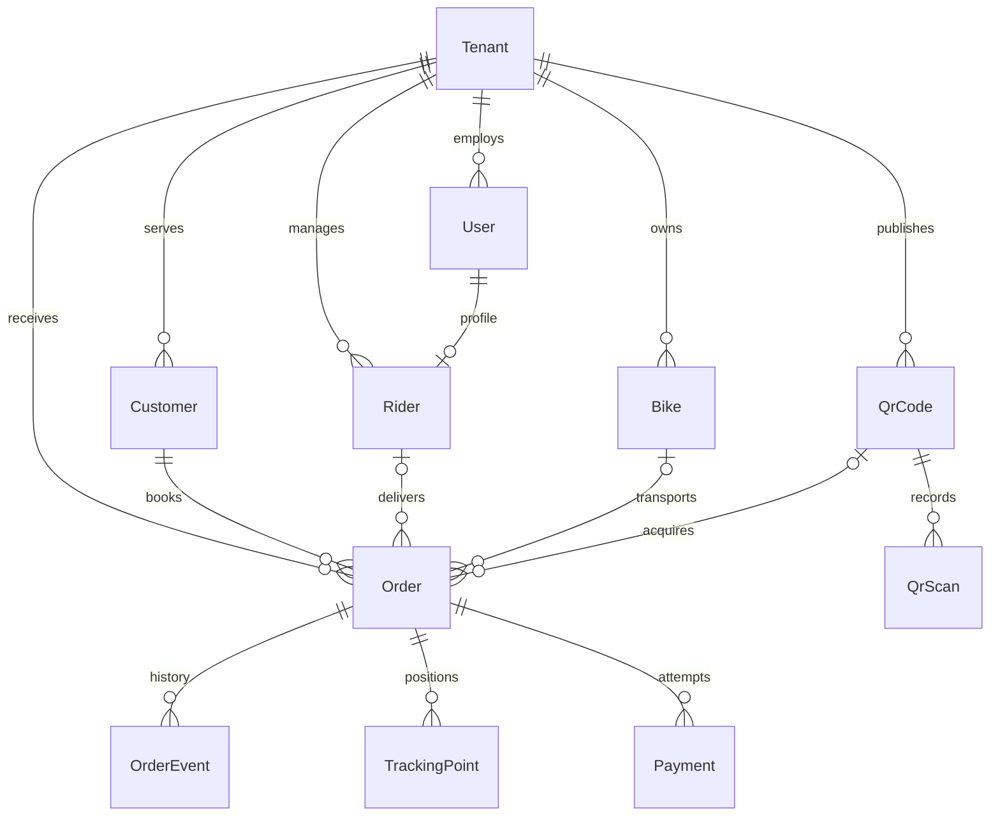

# PostgreSQL database design

This is an initial dispatch MVP schema based on the repository PRD, not a conversion of the pasted compliance application. That example uses MySQL native types (`DateTime`, `Float`) and mostly unrelated entities. PostgreSQL uses native `Timestamptz`, `Decimal`, UUID and actual foreign keys here.

## ER diagram

Render this Mermaid block in a Markdown preview that supports Mermaid.

## Relational schema, keys and constraints

The exact columns and SQL types are defined in `prisma/schema.prisma`; the initial migration is the executable relational schema. Every table has a UUID `id` primary key. UUID defaults are generated by Prisma, so raw SQL inserts must supply IDs. PK means primary key; FK means foreign key; UQ means unique candidate key. All fields are NOT NULL except those marked `?` in Prisma.

| Relation | Foreign keys | Additional unique keys |
| --- | --- | --- |
| Tenant | None | subdomain |
| User | tenantId → Tenant | (tenantId,email), (tenantId,id) |
| Rider | tenantId → Tenant; (tenantId,userId) → User | userId, (tenantId,id) |
| Bike | tenantId → Tenant | (tenantId,serialNumber), (tenantId,id) |
| Customer | tenantId → Tenant | (tenantId,id) |
| QrCode | tenantId → Tenant | code, (tenantId,id) |
| QrScan | qrCodeId → QrCode | None |
| Order | tenantId → Tenant; (tenantId,customerId) → Customer; optional composite links to Rider, Bike, QrCode | trackingCode |
| OrderEvent | orderId → Order | None |
| TrackingPoint | orderId → Order | None |
| Payment | orderId → Order | providerReference (nullable) |

Composite foreign keys enforce tenant consistency even for direct database writes. All deletes use RESTRICT to preserve operational history; introduce an explicit retention/anonymisation policy before deleting customer data. Optional rider/bike/QR IDs support unassigned orders and direct bookings. A user belongs to one tenant; the same email may have separate accounts in different tenants. Customers can book without user accounts. A payment row represents one attempt, allowing retries.

Enums restrict role, order status and payment status. SQL CHECK constraints restrict money to nonnegative amounts, battery to 0–100, latitude to -90–90, longitude to -180–180, and currency to three uppercase letters. Prisma does not express these checks in this schema; retain them in migrations. Indexes support tenant/status/date lists, foreign-key joins, and time-series reads. `@updatedAt` is maintained by Prisma, not a database trigger.

Service logic still must validate legal status transitions, require assigned users to have RIDER role, normalize emails to lowercase before writes, check QR activity, verify payment webhooks, and authorize every query using a tenant derived from authenticated identity. Foreign keys do not authorize reads. No public order endpoints or authentication are implemented in this connection starter. Raw SQL can bypass application rules. No row-level security is configured.

## Normalisation

1. **1NF:** scalar business fields; scans, payments, events and locations use separate rows instead of arrays or comma-separated lists.
2. **2NF:** business attributes depend on the whole candidate key. For example, a tenant's bike serial identifies a bike within that tenant. Junction-style tenant composite keys exist for integrity, while UUIDs provide simple primary keys.
3. **3NF:** tenant branding lives on Tenant; account details on User; rider availability on Rider; bike battery on Bike; customer contact details on Customer. Orders reference those entities rather than duplicating their current attributes. Payment attempts and tracking samples describe their own entities.

This is a practical normalised design with deliberate redundancy: tenantId appears alongside globally unique foreign IDs to enforce isolation using composite FKs. Order.status caches the latest state represented by OrderEvent; update both in a single Prisma transaction. Pickup/delivery addresses and recipient contacts are booking snapshots, so later customer edits must not rewrite deliveries. Payment amount/currency record a historical transaction rather than being recalculated from the current order fee. This redundancy means the entire physical design should not be described as strictly 3NF without qualification.

## Diagram tools

- **dbdiagram.io**: useful for design reviews using DBML or PostgreSQL SQL import. Import the initial migration SQL; preserve the custom checks in the real migration. https://docs.dbdiagram.io/
- **DBeaver**: connect after migrations, then open the schema's ER Diagram to inspect the real tables and foreign keys. https://dbeaver.com/docs/dbeaver/ER-Diagrams/
- **Mermaid**: the relationship overview above is versioned with the code. The migration/schema remains authoritative for columns and constraints.

Prisma Studio (`npm run db:studio`) browses and edits data; use one of the above for an ER diagram.

## Scope

This covers the dispatch data foundation. Subscription billing/trials, service-area polygons and pricing, proof of delivery, notifications, OTP/TOTP, password reset and full auth routes are future modules; they are not supplied by this connection setup. Prefer PostGIS for service-area queries when that module is implemented. Assign a bike to an order here; rider shift/bike assignment history can be added separately.
