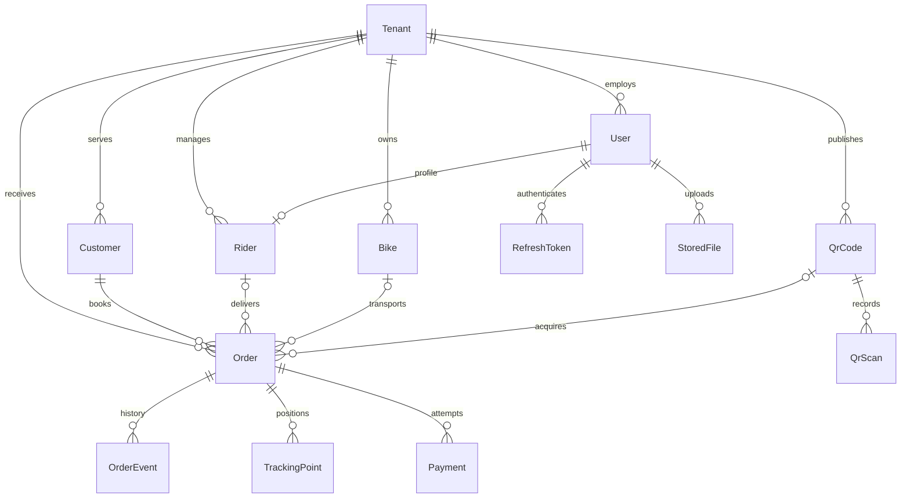
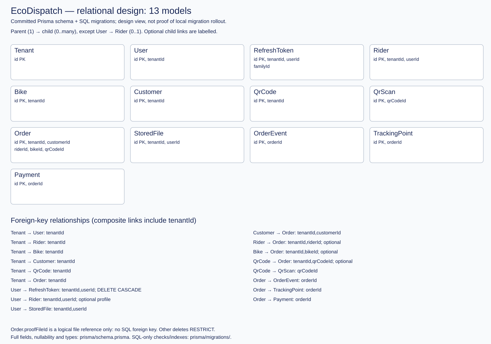

# PostgreSQL database design

EcoDispatch uses PostgreSQL + Prisma for operational data. This guide describes the **13-model committed design**, not the partially migrated local database. See [rollout/recovery status](PHASE_TWO.md); existing assignments must be preserved.

## ER diagram and authoritative schema

The [editable Mermaid ERD](../portfolio-1-database-design/evidence/er-diagram.mmd) describes the same relationships. The older ER PDF is historical. Exact persisted fields, types, defaults and nullability are in [Prisma](../prisma/schema.prisma); [all SQL migrations](../prisma/migrations/) also define checks and partial indexes Prisma cannot express. UUID defaults are generated by Prisma; raw SQL supplies IDs. `@updatedAt` is application-maintained, not a database trigger.

## Keys and relationships

Every relation has UUID `id` as primary key. `?` in Prisma denotes nullable fields. Composite references enforce tenant consistency; they do not authorize reads.

| Relation | Foreign keys | Other unique keys |
| --- | --- | --- |
| Tenant | None | subdomain |
| User | tenantId → Tenant | (tenantId,email), (tenantId,id) |
| RefreshToken | (tenantId,userId) → User | tokenHash |
| Rider | tenantId → Tenant; (tenantId,userId) → User | userId, invitationHash nullable, (tenantId,userId), (tenantId,id) |
| Bike | tenantId → Tenant | (tenantId,serialNumber), (tenantId,id) |
| Customer | tenantId → Tenant | (tenantId,id) |
| QrCode | tenantId → Tenant | code, (tenantId,id) |
| QrScan | qrCodeId → QrCode | None |
| Order | tenantId → Tenant; composite tenant links to Customer and optional Rider/Bike/QrCode | trackingCode; SQL-only active-rider rule |
| StoredFile | (tenantId,userId) → User | key |
| OrderEvent | orderId → Order | None |
| TrackingPoint | orderId → Order | None |
| Payment | orderId → Order | providerReference nullable |

RefreshToken's User reference uses **ON DELETE CASCADE**; other foreign-key deletes restrict removal. RefreshToken and StoredFile derive tenant integrity through User rather than a separate Tenant FK. `Order.proofFileId` has **no SQL FK**: services must validate ownership/existence. Nullable unique strings permit multiple nulls in PostgreSQL.

## Constraints and application responsibilities

SQL enforces nonnegative decimal money, uppercase three-letter currency, battery 0–100, coordinate bounds, paired order endpoint coordinates, GPS accuracy 0–500 and source rules, onboarding values, lowercase account emails and tenant branding/subdomain formats. Enums constrain role, order/payment status and package size. Review migration SQL for exact expressions and null handling; these are not interchangeable with API validation.

The SQL partial unique index permits at most one order per non-null rider in ASSIGNED, PICKED_UP or IN_TRANSIT. Tenant/date, phone, event and tracking indexes support [measured query patterns](PERFORMANCE.md). Foreign keys cannot enforce legal status transitions, RIDER roles, QR activity, payment verification or caller authorization. Services implement those rules; no PostgreSQL row-level security is configured.

Authentication, public booking and Phase 2 services exist in code. Local rollout is pending migration recovery, not a missing implementation. StoredFile contains ownership and S3 metadata, never file bytes; payment modelling is not proof of card processing.

## Normalisation and deliberate redundancy

- **1NF:** scalar columns; events, payment attempts, QR scans and tracking samples are separate rows.
- **2NF:** attributes depend on their complete business key; a bike serial is unique within its tenant, not globally.
- **3NF:** tenant branding, accounts, rider availability, bikes and customer contacts belong to their respective entities rather than being repeated as current attributes on every order.

The physical design deliberately duplicates tenantId for composite foreign keys and caches order status and pickup/delivery timestamps alongside event history. Status, timestamps and audit events require atomic service updates. Booking addresses/recipient contacts and payment amounts are historical snapshots, not values to refresh from current customer/price data. These exceptions must be explained rather than claiming strict 3NF for every stored attribute.
